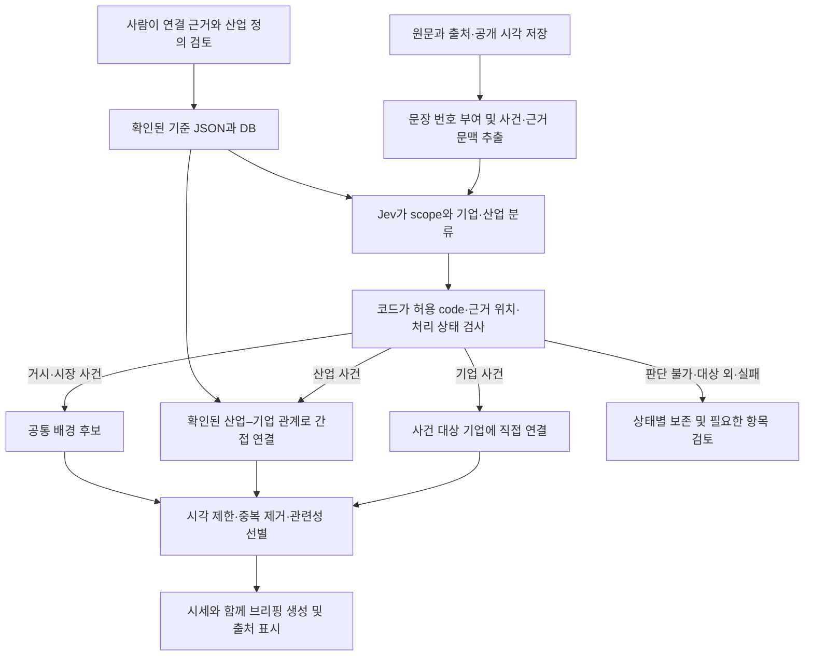

# 산업·종목 연결표

- 작성일: 2026-10-10
- 수정일: 2026-10-12
- 상태: **분류·연결 정책을 보완한 초안.** 100개 종목의 최신 사업보고서 대조는 아직 끝나지 않았다. 3절의 연결은 검토 후보이며, 확인된 연결만 운영 기준에 넣는다.
- 대상: 코스피 시가총액 상위 100개 (BE `backend/app/core/mvp_stocks.py`, 2026-10-06 기준)
- 관련 문서: 표 구조는 [CLASSIFICATION_DB_DRAFT.md](CLASSIFICATION_DB_DRAFT.md), 20개 종목 1차 검증은 [INDUSTRY_REVIEW.md](INDUSTRY_REVIEW.md), 기업–기업 관계(고객·공급사·지분)는 [COMPANY_RELATIONS.md](COMPANY_RELATIONS.md)

---

## 0. 이 파일이 하는 일

기사 속 사건을 기업·산업으로 분류하고, 산업 사건을 관련 종목에 연결할 때 쓰는 기준이다. **사람은 기준을 관리하고, Jev는 입력된 사건의 기업·산업을 분류하고, 코드는 검증된 산업–기업 관계로 자료를 연결한다.** Jev 도입은 제안 단계이며 아직 구현·성능 검증되지 않았다.

```
사건 "D램 가격 상승" + 이 파일의 산업 정의
  → Jev: 산업 사건, 메모리반도체
  → 코드: 확인된 메모리반도체–종목 연결 조회
  → 해당 종목의 간접 근거(업황 배경 후보)로 전달

사건 "삼성전자 자사주 매입 발표" + 종목 후보와 별칭
  → Jev: 기업 사건, 대상 기업은 삼성전자
  → 코드: 종목코드 검증 후 해당 종목의 직접 근거로 전달
```

- 같은 산업에 속한다는 이유만으로 회사 개별 사건을 다른 회사에 퍼뜨리지 않는다. 산업 전반에 관한 사건만 산업 연결 경로를 탄다.
- 산업–기업 연결을 Jev가 새로 만들지 않는다. 사업·지분·공급망 근거를 사람이 검토해 기준에 반영한다.
- **직접·간접은 대상 종목에 대한 연결 경로의 구분이다.** 직접 근거도 주가 변동의 원인으로 입증된 것은 아니다. Jev의 분류 확신도가 높아도 간접 근거가 직접 근거로 바뀌지 않는다.
- 나중에 이 파일을 기준 JSON 으로 옮겨 DB 의 `industries`·`stock_industries` 에 넣는다(변환 코드는 아직 없다).

## 1. 고치는 법

**판단 기준: 회사의 사업·매출·수요·비용·지분을 통해 해당 산업에 노출되는 근거가 있는가.** 주가가 같이 움직였다는 사실만으로 연결하지 않는다. 영향 방향과 실제 주가 변동 원인은 개별 사건 및 브리핑 생성 단계에서 따로 판단한다.

1. DART(dart.fss.or.kr)에서 회사의 최신 사업보고서 **"II. 사업의 내용"** 을 본다.
2. 공식 IR 등을 함께 보고 3절의 `연결할 산업` 이 주요 사업을 다 담는지, 관계없는 산업이 끼어 있지 않은지 본다.
3. **종목–산업 연결 하나마다** 아래 검토 기록을 남긴다. 종목 행의 `확인` 칸에는 확인자·날짜와 기록 위치를 적는다. 일부 연결만 확인됐으면 종목 전체를 `OK`로 표시하지 않는다.
4. 애매하면 혼자 정하지 말고 6절에 올린다.

적는 규칙

- 종목은 근거로 확인할 수 있는 **가장 구체적인 산업**에 연결한다. 그보다 세부적인 사업을 추측하지 않는다.
- 뉴스용 상위 산업은 함께 조회한다(메모리반도체 → 반도체). **KRX 업종까지 자동 확장하지 않는다.** 화면용 업종과 뉴스용 산업의 경계는 2절을 따른다.
- 산업 이름은 겹치지 않게 한다. 3절에서 이름으로 가리킨다.
- 여러 개는 `, ` 로 나눈다.
- 산업 `code` 는 한 번 정하면 바꾸지 않는다. 이름은 바꿔도 된다.
- 기사 단어는 분류를 돕는 표현 예시다. 단어가 있다는 이유만으로 산업을 확정하지 않는다. 국내·해외 기업명과 지수명은 산업 동의어에 넣지 않는다.

### 1-1. 연결 검토 기록

3절은 검토할 후보 목록이다. 운영용 JSON으로 옮기기 전에 각 연결에 다음 정보를 채운다. 빈 `확인` 칸은 미검토 상태이며 운영 승인으로 취급하지 않는다.

| 필드 | 기록할 내용 |
| --- | --- |
| 종목코드·산업 code | 이름 변경과 무관하게 연결을 식별할 값 |
| 연결 유형 | `business`: 직접 영위하는 사업 / `ownership`: 자회사·지분을 통한 노출 / `supply_chain`: 고객·공급망을 통한 노출 |
| 근거 | 사업보고서·공식 IR의 URL 또는 공시번호, 해당 절, 연결을 뒷받침하는 내용 |
| 중요성 | 매출·이익·지분·주요 고객 등 확인 가능한 근거와 기준 기간. 수치가 없으면 없다고 적고 임의 비중을 만들지 않음 |
| 검토 상태 | 미검토 / 확인 / 보류 / 제외. 확인자와 확인일을 함께 기록 |
| 적용 기간·버전 | 알려진 사업 변경 시점과 기준 버전. 과거 시점에 현재 관계를 소급 적용하지 않음 |

- 연결 유형과 근거의 직접·간접은 다르다. `business` 연결이어도 산업 사건을 통해 가져온 자료는 **간접 근거**다.
- 지분 연결은 SK스퀘어만 예외로 두지 않는다. GS·LS·한진칼 등 기존 후보도 같은 기준으로 검토한다. 단순 지분 보유만으로 모든 피투자회사 산업을 자동 상속하지 않는다.
- 공급망 연결은 거래·수요 노출의 근거가 확인될 때만 승인한다. 고객 산업을 부품 회사의 직접 사업으로 기록하지 않는다.
- 산업마다 규모가 다르므로 일률적인 매출 비중 임계값은 아직 정하지 않는다. 중요성 판단 근거를 기록하고 6절에서 검토한다.

---

## 2. 산업 목록

- 맨 위(상위 칸이 `—`인 `krx_*`)는 기존 표를 읽기 위한 KRX 표시 그룹이다. 이름은 BE `sector` 값과 같다. **회사별 화면 업종은 BE 값을 사용하며, 아래 뉴스 산업의 상위 그룹으로부터 역산하지 않는다.**
- 그 아래가 뉴스 연결용 산업이다. Jev의 산업 선택지와 종목 연결에는 `krx_*`를 넣지 않는다. JSON 변환 시 KRX 표시 그룹과 뉴스용 `parent_code`를 분리한다. 예: `memory → semiconductor`, `semiconductor`의 뉴스용 부모는 없음.
- KRX 업종을 그대로 다룬 기사도 사건의 실제 사업 범위로 분류한다. 범위를 알 수 없으면 보류하며, 표시 그룹의 하위 종목 전체로 보내지 않는다.
- `기사 표현 예시`는 문맥 판단용이다. `분류 참고 표기`에는 해외 기업·제품·지수 등이 섞여 있으며 **어느 칸도 그대로 `industries.aliases`에 복사하지 않는다.** 검토된 동의어만 별도로 추린다.
- Jev에 선택지를 제공할 때는 code·이름에 더해 포함 범위·제외 범위·예시를 제공한다. 아래 2-1은 우선 확인할 경계이며, 나머지 산업도 선택지 정의 검토가 필요하다.

| code | 이름 | 상위 / 표시 그룹 | 기사 표현 예시 | 분류 참고 표기 (자동 연결 금지) |
| --- | --- | --- | --- | --- |
| `krx_electronics` | 전기전자 | — | | |
| `semiconductor` | 반도체 | 전기전자 | 반도체 업황, 반도체주, 반도체 수출 | 필라델피아 반도체지수, SOX |
| `memory` | 메모리반도체 | 반도체 | D램, DRAM, 낸드, NAND, HBM, 메모리 반도체 | 마이크론, Micron |
| `foundry` | 파운드리 | 반도체 | 파운드리, 반도체 위탁생산 | TSMC, 글로벌파운드리, UMC |
| `semi_equipment` | 반도체 장비 | 반도체 | 반도체 장비, TC본더, 후공정 장비 | ASML, 어플라이드머티어리얼즈, 램리서치, 도쿄일렉트론 |
| `pcb_substrate` | 기판·PCB | 전기전자 | 기판, FC-BGA, MLB, PCB, CCL, 유리기판 | |
| `smartphone` | 스마트폰 | 전기전자 | 스마트폰, 갤럭시, 폴더블 | 애플, 아이폰 |
| `home_appliance` | 가전 | 전기전자 | TV, 생활가전, 가전 | |
| `electronic_parts` | 전자부품 | 전기전자 | MLCC, 카메라모듈 | 무라타 |
| `battery` | 2차전지 | 전기전자 | 2차전지, 이차전지, 배터리, 전기차 배터리 | |
| `battery_cell` | 배터리셀 | 2차전지 | 배터리셀, 배터리 셀 | CATL, 파나소닉 |
| `battery_materials` | 배터리 소재 | 2차전지 | 양극재, 음극재, 전구체, 리튬, 동박 | 앨버말 |
| `power_grid` | 전력 인프라 | 전기전자 | 전력 인프라, 전력망, 데이터센터 전력 | |
| `grid_equipment` | 전력기기 | 전력 인프라 | 변압기, 차단기, 배전반, 초고압 | |
| `cable` | 전선 | 전력 인프라 | 전선, 해저케이블, 초고압 케이블 | |
| `krx_transport_equip` | 운송장비·부품 | — | | |
| `auto` | 자동차 | 운송장비·부품 | 완성차, 자동차 판매, 자동차 관세 | |
| `auto_parts` | 자동차부품 | 운송장비·부품 | 자동차부품, 타이어 | |
| `shipbuilding` | 조선 | 운송장비·부품 | 조선, 조선업, LNG운반선, 컨테이너선, 신조선가 | 클락슨 |
| `defense_aerospace` | 방산·항공우주 | 운송장비·부품 | 방산, 방위산업, K방산, 무기 수출, 항공우주, 위성 | |
| `krx_pharma` | 제약 | — | | |
| `biopharma` | 바이오의약품 | 제약 | CDMO, 위탁개발생산, 바이오시밀러, 생물보안법 | 론자, 우시바이오로직스 |
| `pharma_drug` | 신약·제약 | 제약 | 신약, 임상, 기술수출, 비만치료제 | 일라이릴리, 노보노디스크 |
| `krx_finance` | 금융 | — | | |
| `bank` | 은행 | 금융 | 은행, 시중은행, 순이자마진, NIM | |
| `holding` | 지주회사 | 금융 | 지주사, 지주회사, 지배구조, 상법 개정 | |
| `fintech` | 핀테크 | 금융 | 핀테크, 간편결제, 스테이블코인 | |
| `krx_securities` | 증권 | — | | |
| `securities` | 증권사 | 증권 | 증권사, 증권주, 거래대금, 브로커리지 | |
| `krx_insurance` | 보험 | — | | |
| `life_insurance` | 생명보험 | 보험 | 생명보험, 생보사 | |
| `nonlife_insurance` | 손해보험 | 보험 | 손해보험, 손보사, 자동차보험 | |
| `krx_machinery` | 기계·장비 | — | | |
| `power_equipment` | 발전설비 | 기계·장비 | 원전, 원자력, SMR, 가스터빈, 발전설비 | |
| `construction_machinery` | 건설기계 | 기계·장비 | 건설기계, 굴착기, 건설장비 | 캐터필러 |
| `krx_construction` | 건설 | — | | |
| `construction` | 건설·플랜트 | 건설 | 건설사, 건설업, 주택, 분양, 플랜트, 해외수주 | |
| `krx_chemical` | 화학 | — | | |
| `refining` | 정유 | 화학 | 정유, 정유사, 정제마진 | |
| `petrochemical` | 석유화학 | 화학 | 석유화학, 에틸렌, NCC | |
| `solar` | 태양광 | 화학 | 태양광, 폴리실리콘 | 퍼스트솔라 |
| `cosmetics` | 화장품 | 화학 | 화장품, K뷰티, 뷰티 디바이스 | |
| `krx_metal` | 금속 | — | | |
| `steel` | 철강 | 금속 | 철강, 열연, 후판, 철광석 | |
| `nonferrous` | 비철금속 | 금속 | 비철금속, 아연, 귀금속 | LME |
| `krx_logistics` | 운송·창고 | — | | |
| `shipping` | 해운 | 운송·창고 | 해운, 컨테이너 운임, 자동차운반선 | SCFI |
| `airline` | 항공 | 운송·창고 | 항공사, 항공 여객, 유류할증료 | |
| `krx_utility` | 전기·가스 | — | | |
| `utility` | 전력·가스 | 전기·가스 | 전기요금, 가스요금, 전력도매가격, SMP | |
| `krx_telecom` | 통신 | — | | |
| `telecom` | 통신사 | 통신 | 통신사, 이동통신, 요금제 | |
| `krx_it_service` | IT 서비스 | — | | |
| `internet_platform` | 인터넷 플랫폼 | IT 서비스 | 플랫폼, 포털, 검색광고 | |
| `it_service` | IT 서비스·SI | IT 서비스 | SI, 클라우드, 디지털전환 | |
| `game` | 게임 | IT 서비스 | 게임, 게임주, 신작 | |
| `krx_food` | 음식료·담배 | — | | |
| `food` | 음식료 | 음식료·담배 | 라면, K푸드, 식품 수출 | |
| `tobacco` | 담배 | 음식료·담배 | 담배, 궐련, 전자담배 | |
| `krx_entertainment` | 오락·문화 | — | | |
| `entertainment` | 엔터 | 오락·문화 | 엔터, K팝, 아이돌, 앨범 판매 | |
| `krx_services` | 일반서비스 | — | | |
| `rental` | 생활가전 렌탈 | 일반서비스 | 렌탈, 정수기 | |
| `krx_distribution` | 유통 | — | | |
| `trading` | 종합상사 | 유통 | 종합상사, 상사 | |

### 2-1. 혼동하기 쉬운 분류 경계

| 표현·범위 | 포함 기준 | 제외·보류 기준 |
| --- | --- | --- |
| 파운드리 / 시스템반도체 | 반도체 위탁생산 사업·수요·가격·가동률은 `foundry` | 시스템반도체 설계·제품 이야기를 파운드리로 단정하지 않음. 세부 범위가 없으면 `semiconductor` 또는 보류 |
| 메모리 / 반도체 장비 | 메모리 제품 수요·가격은 `memory`, 제조 장비 수주·투자는 `semi_equipment` | HBM이라는 단어만으로 모든 사건을 메모리로 분류하지 않음. 한미반도체의 장비 사업을 메모리 제조로 바꾸지 않음 |
| ESS | 셀 수요·생산은 `battery_cell`, 소재는 `battery_materials`, 전력망 수요는 해당 전력 산업 | ESS 전체를 배터리셀의 동의어로 쓰지 않음. 관련 산업이 여러 개면 사건별로 복수 분류 |
| 원전 | 원자로·발전 장비는 `power_equipment`, 시공은 `construction`, 전력 판매·요금은 `utility` | 원전이라는 단어만으로 시공사·전력회사 모두를 발전설비 회사로 연결하지 않음 |
| 방산 / 조선 | 함정·잠수함의 방위사업 내용은 방산, 선박 건조·업황은 조선으로 문맥 분류 | 조선사라는 이유만으로 모든 방산 사건을 전달하지 않음. 종목의 방산 연결은 별도 사업 근거 필요 |
| 바이오의약품 | 현재 `biopharma`는 CDMO와 바이오시밀러를 포괄 | 두 사업을 같은 것으로 해석하지 않음. 사건에 세부 사업 표기를 보존하고 후보별 관련성 확인. 분리 여부는 6절 |
| 지주회사 / 지배구조 | 지주회사 제도·사업을 다루면 `holding` | 상법 개정·지배구조라는 단어만으로 지주회사 사건으로 단정하지 않음. 적용 대상 확인 |
| 플랫폼·SI·기판·상사·주택 | 인터넷 서비스, 시스템 통합, 전자회로 기판, 종합상사, 주택 건설 등 사업 문맥 확인 | 일반적인 플랫폼·직장 상사 등 동음이의어, 맥락 없는 약어는 보류 |
| AI 데이터센터 | 서버 기판·전력기기·클라우드 등 원문에 드러난 사업 범위로 분류 | AI라는 단어만으로 관련 테마 종목 전체에 전달하지 않음 |

ESS·원전·AI 데이터센터 같은 교차 주제는 원문 표기로 보존한다. 별도 테마 체계를 도입하기 전까지 주제 자체에서 종목으로 자동 확장하지 않는다.

---

## 3. 종목별 연결

KRX 업종별로 묶은 **연결 후보 목록**이다. 업종 하나씩 나눠 맡되, 승인 여부는 1-1의 종목–산업별 기록으로 관리한다. 아래 이름·사업 메모도 최신 공시 검증이 끝난 사실 목록은 아니다.

- `연결할 산업`: 2절의 이름으로 적은 후보. 화면 섹터(KRX 업종)와 달라도 된다. 여러 산업 중 확인된 연결만 운영용으로 내보낸다.
- `별칭`: 종목명 말고 기사에 나오는 다른 표기. 5절의 주의 사항을 지킨다.
- `메모`의 **확인**: 초안 작성자가 확신하지 못한 부분이다. 먼저 본다.

### 전기전자 (20)

| 순위 | 코드 | 종목 | 연결할 산업 | 별칭 | 메모 | 확인 |
| --- | --- | --- | --- | --- | --- | --- |
| 1 | 005930 | 삼성전자 | 메모리반도체, 파운드리, 스마트폰, 가전 | 삼전, Samsung Electronics | | |
| 2 | 000660 | SK하이닉스 | 메모리반도체 | 하이닉스, 하닉, SK hynix | | |
| 3 | 005935 | 삼성전자우 | 메모리반도체, 파운드리, 스마트폰, 가전 | | 우선주. 삼성전자와 같게 둔다. 6절 3번 | |
| 5 | 009150 | 삼성전기 | 전자부품, 기판·PCB | | MLCC·카메라모듈 + 패키지기판 | |
| 6 | 373220 | LG에너지솔루션 | 배터리셀 | LG엔솔, 엔솔, LGES | | |
| 17 | 006400 | 삼성SDI | 배터리셀 | | | |
| 21 | 066570 | LG전자 | 가전 | | | |
| 23 | 010120 | LS ELECTRIC | 전력기기 | LS일렉트릭, LS산전 | LS산전은 옛 이름 | |
| 26 | 298040 | 효성중공업 | 전력기기 | | 건설 부문도 있음. 건설·플랜트 연결 여부 **확인** | |
| 31 | 267260 | HD현대일렉트릭 | 전력기기 | 현대일렉트릭 | | |
| 35 | 000150 | 두산 | 지주회사, 기판·PCB | ㈜두산 | 전자BG(CCL). 두산에너빌리티 지분 → 발전설비 연결은 6절 1번. **확인** | |
| 48 | 003670 | 포스코퓨처엠 | 배터리 소재 | 포스코케미칼 | 포스코케미칼은 옛 이름 | |
| 51 | 272210 | 한화시스템 | 방산·항공우주 | | | |
| 55 | 011070 | LG이노텍 | 전자부품, 스마트폰, 기판·PCB | | 스마트폰은 공급망 연결 후보. 카메라모듈의 고객·수요 노출 근거를 확인하고 직접 사업과 구분 | |
| 68 | 000500 | 가온전선 | 전선 | | | |
| 75 | 007660 | 이수페타시스 | 기판·PCB | | AI 서버용 MLB | |
| 81 | 353200 | 대덕전자 | 기판·PCB | | | |
| 85 | 062040 | 산일전기 | 전력기기 | | 특수변압기 | |
| 91 | 001440 | 대한전선 | 전선 | | | |
| 92 | 000990 | DB하이텍 | 파운드리 | | 8인치 파운드리 | |

### 금융 (19)

| 순위 | 코드 | 종목 | 연결할 산업 | 별칭 | 메모 | 확인 |
| --- | --- | --- | --- | --- | --- | --- |
| 4 | 402340 | SK스퀘어 | 지주회사, 메모리반도체 | | SK하이닉스 지분 | |
| 9 | 105560 | KB금융 | 은행 | KB금융지주 | | |
| 14 | 055550 | 신한지주 | 은행 | 신한금융지주, 신한금융 | | |
| 19 | 034730 | SK | 지주회사 | SK㈜ | 그룹명과 같음. 5절 | |
| 20 | 086790 | 하나금융지주 | 은행 | 하나금융 | | |
| 29 | 316140 | 우리금융지주 | 은행 | 우리금융 | | |
| 33 | 009540 | HD한국조선해양 | 조선, 지주회사 | 한국조선해양 | 조선 중간지주 | |
| 36 | 138040 | 메리츠금융지주 | 손해보험, 증권사 | 메리츠금융 | 메리츠화재 + 메리츠증권 | |
| 46 | 003550 | LG | 지주회사 | ㈜LG | 그룹명과 같음. 5절 | |
| 49 | 024110 | 기업은행 | 은행 | IBK기업은행 | | |
| 50 | 267250 | HD현대 | 지주회사, 조선, 정유 | | 조선 지분 + HD현대오일뱅크. 그룹명과 같음. **확인** | |
| 64 | 071050 | 한국금융지주 | 증권사 | | 한국투자증권 지주. 5절(증권사 이름) | |
| 67 | 078930 | GS | 지주회사, 정유 | ㈜GS | GS칼텍스 지분. 그룹명과 같음 | |
| 69 | 323410 | 카카오뱅크 | 은행 | 카뱅 | | |
| 71 | 006260 | LS | 지주회사, 전선 | ㈜LS | LS전선 지분. 그룹명과 같음 | |
| 74 | 0126Z0 | 삼성에피스홀딩스 | 지주회사, 바이오의약품 | | 삼성바이오에피스(바이오시밀러) 지주. **확인** | |
| 76 | 180640 | 한진칼 | 지주회사, 항공 | | 대한항공 지주 | |
| 97 | 377300 | 카카오페이 | 핀테크 | | | |
| 98 | 175330 | JB금융지주 | 은행 | JB금융 | | |

### 운송장비·부품 (10)

| 순위 | 코드 | 종목 | 연결할 산업 | 별칭 | 메모 | 확인 |
| --- | --- | --- | --- | --- | --- | --- |
| 7 | 005380 | 현대차 | 자동차 | 현대자동차 | | |
| 12 | 012450 | 한화에어로스페이스 | 방산·항공우주 | 한화에어로 | | |
| 15 | 329180 | HD현대중공업 | 조선 | 현대중공업 | 함정(특수선)도 있음. 방산 연결 여부 **확인** | |
| 16 | 000270 | 기아 | 자동차 | 기아차 | | |
| 22 | 012330 | 현대모비스 | 자동차부품 | 모비스 | | |
| 32 | 042660 | 한화오션 | 조선 | 대우조선해양 | 대우조선해양은 옛 이름. 잠수함(특수선) 있음. 방산 연결 여부 **확인** | |
| 43 | 010140 | 삼성중공업 | 조선 | 삼성중 | | |
| 57 | 047810 | 한국항공우주 | 방산·항공우주 | KAI | | |
| 59 | 064350 | 현대로템 | 방산·항공우주 | | K2 전차 + 철도 | |
| 93 | 005387 | 현대차2우B | 자동차 | | 우선주. 현대차와 같게 | |

### 화학 (9)

| 순위 | 코드 | 종목 | 연결할 산업 | 별칭 | 메모 | 확인 |
| --- | --- | --- | --- | --- | --- | --- |
| 28 | 096770 | SK이노베이션 | 정유, 석유화학, 배터리셀 | SK이노 | SK온(배터리) | |
| 40 | 010950 | S-Oil | 정유, 석유화학 | 에쓰오일 | | |
| 41 | 051910 | LG화학 | 석유화학, 배터리 소재 | | LG에너지솔루션 지분 → 배터리셀 연결은 6절 1번 | |
| 54 | 278470 | 에이피알 | 화장품 | APR | 뷰티 디바이스 | |
| 77 | 009830 | 한화솔루션 | 태양광, 석유화학 | | | |
| 79 | 090430 | 아모레퍼시픽 | 화장품 | 아모레 | | |
| 80 | 161390 | 한국타이어앤테크놀로지 | 자동차부품 | 한국타이어 | | |
| 86 | 000880 | 한화 | 지주회사, 방산·항공우주 | ㈜한화 | 한화에어로스페이스 지분. 그룹명과 같음. **확인** | |
| 100 | 011790 | SKC | 배터리 소재, 기판·PCB | | 동박, 반도체 유리기판. 사업 구성이 바뀌는 중이라 **확인** | |

### IT 서비스 (6)

| 순위 | 코드 | 종목 | 연결할 산업 | 별칭 | 메모 | 확인 |
| --- | --- | --- | --- | --- | --- | --- |
| 24 | 035420 | NAVER | 인터넷 플랫폼 | 네이버 | | |
| 45 | 018260 | 삼성에스디에스 | IT 서비스·SI | 삼성SDS | | |
| 53 | 035720 | 카카오 | 인터넷 플랫폼 | | | |
| 62 | 307950 | 현대오토에버 | IT 서비스·SI | | 현대차그룹 SI. 자동차 연결 여부 **확인** | |
| 72 | 259960 | 크래프톤 | 게임 | | | |
| 84 | 064400 | LG씨엔에스 | IT 서비스·SI | LG CNS | | |

### 제약 (4)

| 순위 | 코드 | 종목 | 연결할 산업 | 별칭 | 메모 | 확인 |
| --- | --- | --- | --- | --- | --- | --- |
| 8 | 207940 | 삼성바이오로직스 | 바이오의약품 | 삼바, 삼성바이오 | | |
| 18 | 068270 | 셀트리온 | 바이오의약품 | | | |
| 89 | 128940 | 한미약품 | 신약·제약 | | | |
| 96 | 000100 | 유한양행 | 신약·제약 | | | |

### 기계·장비 (4)

| 순위 | 코드 | 종목 | 연결할 산업 | 별칭 | 메모 | 확인 |
| --- | --- | --- | --- | --- | --- | --- |
| 13 | 034020 | 두산에너빌리티 | 발전설비 | 두산에너빌 | | |
| 27 | 042700 | 한미반도체 | 반도체 장비 | | HBM 장비(TC본더). 메모리는 공급망 연결 후보로 별도 검토. 동반 주가 움직임만으로 추가하지 않음 | |
| 95 | 267270 | HD건설기계 | 건설기계 | HD현대건설기계 | 옛 이름·합병 관계 **확인** | |
| 99 | 241560 | 두산밥캣 | 건설기계 | 밥캣 | | |

### 증권 (4)

| 순위 | 코드 | 종목 | 연결할 산업 | 별칭 | 메모 | 확인 |
| --- | --- | --- | --- | --- | --- | --- |
| 44 | 006800 | 미래에셋증권 | 증권사 | | 5절(증권사 이름) | |
| 66 | 005940 | NH투자증권 | 증권사 | | 5절(증권사 이름) | |
| 78 | 016360 | 삼성증권 | 증권사 | | 5절(증권사 이름) | |
| 87 | 039490 | 키움증권 | 증권사 | | 5절(증권사 이름) | |

### 일반서비스 (4)

| 순위 | 코드 | 종목 | 연결할 산업 | 별칭 | 메모 | 확인 |
| --- | --- | --- | --- | --- | --- | --- |
| 63 | 443060 | HD현대마린솔루션 | 조선 | | 선박 AS | |
| 70 | 028050 | 삼성E&A | 건설·플랜트 | 삼성엔지니어링 | 삼성엔지니어링은 옛 이름 | |
| 83 | 021240 | 코웨이 | 생활가전 렌탈 | | | |
| 94 | 326030 | SK바이오팜 | 신약·제약 | | | |

### 보험 (3)

| 순위 | 코드 | 종목 | 연결할 산업 | 별칭 | 메모 | 확인 |
| --- | --- | --- | --- | --- | --- | --- |
| 10 | 032830 | 삼성생명 | 생명보험 | | | |
| 25 | 000810 | 삼성화재 | 손해보험 | | | |
| 60 | 005830 | DB손해보험 | 손해보험 | DB손보 | | |

### 금속 (3)

| 순위 | 코드 | 종목 | 연결할 산업 | 별칭 | 메모 | 확인 |
| --- | --- | --- | --- | --- | --- | --- |
| 30 | 005490 | POSCO홀딩스 | 철강, 배터리 소재, 지주회사 | 포스코홀딩스 | 리튬. "포스코" 단독은 쓰지 않는다(5절) | |
| 34 | 010130 | 고려아연 | 비철금속 | | | |
| 47 | 079550 | LIG디펜스앤에어로스페이스 | 방산·항공우주 | LIG넥스원 | 옛 이름 **확인** | |

### 운송·창고 (3)

| 순위 | 코드 | 종목 | 연결할 산업 | 별칭 | 메모 | 확인 |
| --- | --- | --- | --- | --- | --- | --- |
| 37 | 011200 | HMM | 해운 | | | |
| 52 | 086280 | 현대글로비스 | 해운 | 글로비스 | 자동차운반선. 현대차그룹 물류라 자동차 연결 여부 **확인** | |
| 61 | 003490 | 대한항공 | 항공 | | | |

### 통신 (3)

| 순위 | 코드 | 종목 | 연결할 산업 | 별칭 | 메모 | 확인 |
| --- | --- | --- | --- | --- | --- | --- |
| 39 | 017670 | SK텔레콤 | 통신사 | SKT | | |
| 56 | 030200 | KT | 통신사 | | "KT&G" 와 글자가 겹친다(5절) | |
| 90 | 032640 | LG유플러스 | 통신사 | LGU+ | | |

### 유통 (2)

| 순위 | 코드 | 종목 | 연결할 산업 | 별칭 | 메모 | 확인 |
| --- | --- | --- | --- | --- | --- | --- |
| 11 | 028260 | 삼성물산 | 지주회사, 건설·플랜트, 종합상사 | | 삼성바이오로직스 지분 → 6절 1번 | |
| 65 | 047050 | 포스코인터내셔널 | 종합상사 | 포스코인터 | LNG 사업도 있음 | |

### 음식료·담배 (2)

| 순위 | 코드 | 종목 | 연결할 산업 | 별칭 | 메모 | 확인 |
| --- | --- | --- | --- | --- | --- | --- |
| 42 | 033780 | KT&G | 담배 | | | |
| 73 | 003230 | 삼양식품 | 음식료 | | | |

### 건설 (2)

| 순위 | 코드 | 종목 | 연결할 산업 | 별칭 | 메모 | 확인 |
| --- | --- | --- | --- | --- | --- | --- |
| 58 | 000720 | 현대건설 | 건설·플랜트 | | 원전 시공도 있음. 발전설비 연결 여부 **확인** | |
| 82 | 047040 | 대우건설 | 건설·플랜트 | | | |

### 전기·가스 (1)

| 순위 | 코드 | 종목 | 연결할 산업 | 별칭 | 메모 | 확인 |
| --- | --- | --- | --- | --- | --- | --- |
| 38 | 015760 | 한국전력 | 전력·가스 | 한전, KEPCO | 원전 수출 주체. 발전설비 연결 여부 **확인** | |

### 오락·문화 (1)

| 순위 | 코드 | 종목 | 연결할 산업 | 별칭 | 메모 | 확인 |
| --- | --- | --- | --- | --- | --- | --- |
| 88 | 352820 | 하이브 | 엔터 | | | |

---

## 4. 해외 기업·지수와 경쟁사

**국내·해외에 같은 규칙을 적용한다.** 기업 이름은 산업의 동의어가 아니다. 경쟁사·거래처 관계에 따른 기업 사건 전파는 현재 자동 연결 범위에서 제외한다.

- "SK하이닉스 HBM 수주"는 회사 사건이다. 같은 산업이라는 이유로 삼성전자에 보내지 않는다.
- "TSMC 실적 호조"도 회사 사건이다. TSMC가 국내 대상 종목 밖에 있어도 `industry`로 바꾸지 않는다. 외부 기업 표기와 대상 외 상태를 보존한다.
- 같은 기사에 "파운드리 업계 가동률이 상승했다"는 근거가 있으면 **별도 산업 사건**으로 추출·분류하고, 확인된 파운드리 종목에 간접 근거로 전달한다.
- 산업 사건도 회사별 영향 방향은 다를 수 있다. 연결됐다는 이유만으로 수혜·악재를 확정하지 않는다.

| 표기 | 처리 |
| --- | --- |
| 엔비디아·테슬라·TSMC 등 | 기업으로 인식. 국내 연결 대상이 없으면 대상 외로 남김. 원문에 산업 전반의 별도 사건이 있을 때만 해당 사건을 산업으로 분류 |
| SOX·나스닥의 등락 | `market` 사건으로 분류. 지수 구성 산업의 개별 기업 원인으로 자동 변환하지 않음 |
| SCFI 등 운임 지표 | 해운 운임을 다루는 사건인지 확인 후 산업 분류. 지수라는 이유로 모두 `market`으로 묶지 않음 |
| LME·클락슨 등 | 거래소·기관·지표·인용 출처 중 어떤 역할인지 문맥으로 판단. 이름만으로 산업 연결 금지 |

## 5. 별칭 주의

기사에서 표기를 찾을 때 잘못 붙기 쉬운 경우다.

| 경우 | 예 | 처리 |
| --- | --- | --- |
| 그룹명과 같은 종목명 | SK, LG, GS, LS, 한화, 두산, HD현대 | "SK그룹", "LG 계열사" 처럼 그룹을 말하는 경우가 많다. 종목명 그대로는 걸지 않고 `㈜LG`·`SK㈜` 같은 표기만 건다 |
| 여러 회사를 가리키는 표기 | 삼성, 현대, 포스코 | 별칭에 넣지 않는다. 연결 안 된 표기로 남긴다 |
| 다른 종목명 안에 들어가는 이름 | KT ⊂ KT&G, LG ⊂ LG전자, 기아 ⊂ 기아차 | 긴 등록 명칭 우선, 겹치는 범위 제거. 한국어 조사("삼성전자는")를 허용하되 다른 회사명 일부를 별도 기업으로 잡지 않도록 검증 |
| 증권사 이름 | 미래에셋증권, NH투자증권, 삼성증권, 키움증권, 한국투자증권 | 기사에 **리포트 출처**로 자주 나온다("삼성증권은 목표가를 …"). 그대로 걸면 증권사 종목에 엉뚱한 기사가 붙는다 |
| 옛 이름 | LS산전, 대우조선해양, 삼성엔지니어링, 포스코케미칼 | 기업 동일성과 명칭 사용 기간을 확인해 별칭에 넣음. 합병·분할 이전 기사를 현 종목에 무조건 연결하지 않음 |
| 우선주 | 삼성전자우, 현대차2우B | 기업 공통 사건과 특정 주식 종류의 사건을 구분. 아래 규칙 적용 |

증권사 이름 문제는 `company` 여부만으로 풀리지 않는다. Jev가 **사건 대상과 의견·인용 출처를 구분**해야 한다. "삼성증권은 삼성전자 목표주가를 올렸다"의 대상은 삼성전자이고 의견 출처는 삼성증권이다. 반대로 삼성증권 자체 실적 발표는 삼성증권의 직접 자료다.

우선주는 종목코드를 유지하되, 검증된 동일 기업–주식 종류 관계를 별도로 둔다. 기업 전체의 실적·사업 사건은 같은 기업의 보통주·우선주에 직접 자료로 연결할 수 있으며 경로를 기록한다. 보통주 자사주 매입·특정 종류 배당·우선주 수급처럼 적용 범위가 제한된 사건은 해당 종목에만 연결한다. 이 규칙은 산업 경유 연결과 다르며, 동일 기업 관계도 아직 구현되지 않았다.

## 6. 정해야 할 것

| # | 질문 | 초안 |
| --- | --- | --- |
| 1 | 지분·공급망 노출의 중요성을 어떻게 검토하나 | 특정 회사 예외 없이 1-1 적용. 기존 후보도 근거를 채우기 전까지 미승인. 운영 승인에 필요한 중요성 기준은 검토 사례로 정함 |
| 2 | 기업 사건을 경쟁사에 전달하나 | 현재 제외. 향후 별도 관계 모델과 검증이 있어야 허용하며, 허용해도 간접 근거. 관계 모델 방향은 [COMPANY_RELATIONS.md](COMPANY_RELATIONS.md) (2026-10-21 멘토 피드백: 관계는 후보 생성기, 관련성은 기사로 재판정) |
| 3 | 우선주 처리 | BE 목록 유지. 5절의 동일 기업 관계와 사건 적용 범위 검증을 구현해야 함 |
| 4 | 바이오의약품을 CDMO·바이오시밀러로 나누나 | 현재 후보 목록은 유지. 세부 사업별 오연결·누락을 측정한 뒤 code 추가 여부 결정 |
| 5 | 조선사 특수선 사업 연결 | 자동 제외·포함하지 않음. 실제 방산 사업 근거와 중요성을 회사별 검토 |
| 6 | 원전 관련 회사 연결 | 설비·시공·운영 역할을 분리. 원전 참여만으로 모두 발전설비에 넣지 않음 |
| 7 | 해외 기업 사건 | 대상 외 기업으로 보존. 별도 산업 사건만 연결. 해외 기업 식별자 저장 방식은 구현 시 결정 |
| 8 | Jev 채택과 판단 임계값 | 8절의 한국어 평가를 거쳐 결정. 확률 숫자만 보고 운영 승인하지 않음 |

## 7. 기존 초안(CLASSIFICATION_DB_DRAFT 9절)과 달라진 점

| 무엇 | 전 | 후 | 이유 |
| --- | --- | --- | --- |
| 대상 종목 | 20개 | 100개 | BE `MVP_STOCKS` 가 100개 |
| KRX 업종 | 7개 | 18개 | 100개 종목의 업종을 모두 담음 |
| 2차전지 | `battery` 하나 | `battery` 아래 `battery_cell`·`battery_materials` | 셀과 소재는 사업 및 뉴스의 대상 범위가 다르다 |
| 전자부품 | MLCC·카메라모듈·반도체 기판 | 기판을 `pcb_substrate` 로 분리 | AI 서버 기판 뉴스와 스마트폰 부품 뉴스가 다르다 |
| 건설 세부 산업 이름 | 건설 | 건설·플랜트 | KRX 업종 이름과 겹치지 않게 |
| 산업 표현 | 없음 | 문맥 판단용 예시로 제공 | 자동 매칭용 동의어는 별도 검토 필요 |
| 해외 기업·지수 | 없음 | 참고 표기로 제공 | 산업 동의어에서 제외하고 4절에 따라 사건별 분류 |

### 2026-10-12 정책 보완과 구현 전 조정 사항

이번 수정은 이 파일에만 반영했다. 관련 DB 초안·코드에는 아래 변경이 아직 적용되지 않았으므로 그대로 구현하면 안 된다.

- 기준 JSON은 검토된 연결만 내보내고 유형·근거·적용 기간을 담아야 한다. 3절 이름 기반 후보 표를 운영 기준으로 바로 변환하지 않는다.
- KRX 표시 그룹을 뉴스 산업의 `parent_code`와 분리한다. 뉴스용 상위 산업을 통한 조회만 허용한다.
- 기존 DB 초안은 LLM이 표기만 추출하고 사전이 연결하는 방식이다. Jev가 허용 목록의 기업·산업 code를 선택하는 방식으로 바꾸려면 연결 방식, 모델·질문 버전, 보류·대상 외 상태의 저장 규약을 맞춰야 한다.
- 해외 기업·동일 기업의 여러 주식 종류를 표현하는 방식은 별도 설계가 필요하다. 현 종목코드만으로 외부 기업을 표현하지 않는다.
- 분류 시 사용한 기준 버전과 종목별 조립 시 사용한 연결 버전을 모두 남긴다. 기존 초안의 "조립은 항상 지금 기준" 규칙은 과거 브리핑 재현에 충분하지 않다.
- `macro`·`market`은 공통 배경 후보로 관리하며, 산업 근거와 경로를 구분한다. 공통 자료를 모든 브리핑에 무조건 노출하지 않는다.

## 8. Jev 분류와 종목별 조립 워크플로우

**Jev의 역할은 본 분류다.** 이 MAP을 만드는 역할이나 분류 후 검증에만 쓰는 역할이 아니다. 원문에서 마련한 사건·근거 문맥과 허용된 기업·산업 정의를 받아 대상과 scope를 판단한다. 공식 기능은 [TypeSafe 문서](https://docs.typesafe.ai/introduction)를 참고한다(2026-10-12 확인).



### 8-1. 입력과 질문

- 기사에 여러 사건이 있으면 사건별로 분류한다. 원문 문장 번호와 필요한 앞뒤 문맥을 함께 준다. 사건 후보 추출은 코드·기존 LLM의 역할로 두고 Jev가 자유 형식 사건 목록을 생성한다고 가정하지 않는다.
- `Choice`로 `company / industry / macro / market / unresolved` 중 사건 범위를 고를 수 있다. 기업이나 산업의 복수 선택은 후보별 `Noul` 질문 등으로 설계한다. 기사를 단일 기업·산업으로 강제하지 않는다.
- 기업 질문은 사건 대상인지, 단순 언급·의견 출처인지 구분한다. 기사에 없는 기업을 상식으로 추론해 직접 대상으로 만들지 않는다.
- 산업 선택지는 code·정의·포함/제외 조건을 포함한다. 종목–산업 연결표 전체를 보고 관련 기업을 추측하도록 시키지 않는다. 산업에서 종목을 찾는 일은 코드가 한다.
- 기업 대상과 산업 배경이 독립된 주장으로 함께 있으면 사건을 나눠 각각의 근거를 보존한다. 기업 사건에 산업 단어가 있다는 이유로 산업 사건을 추가하지 않는다.
- 후보를 사전으로 좁히는 경우 누락률도 평가한다. 후보 밖·해당 없음·판단 불가를 허용하고, 실패한 요청과 정상적인 보류를 구분한다.
- 한 호출의 질문들은 독립적으로 평가된다. scope 답을 후속 질문이 이미 안다고 가정하지 않는다. 질문마다 충분한 조건을 주거나, 앞 결과가 필요한 질문은 별도 단계로 실행한다.

### 8-2. 직접·간접 근거와 조립 규칙

| 원문 사건 예시 | 분류 | 대상 종목에 전달할 근거 |
| --- | --- | --- |
| 삼성전자 자사주 매입 발표 | 기업·삼성전자 | 적용 주식 종류를 확인해 직접 근거 |
| D램 가격 상승 | 산업·메모리반도체 | 확인된 연결을 통해 해당 종목에 간접 근거 |
| 삼성증권이 삼성전자 목표주가 상향 | 기업·삼성전자, 의견 출처·삼성증권 | 삼성전자의 직접 자료이되 애널리스트 의견으로 보존. 삼성증권 자체 사건으로 연결하지 않음 |
| TSMC 자체 실적 발표 | 기업·TSMC | 대상 외 기업 사건 보존. 국내 파운드리 종목으로 자동 전파하지 않음 |
| 파운드리 업계 가동률 상승 | 산업·파운드리 | 확인된 파운드리 종목에 간접 근거 |
| 코스피 상승 | 시장 | 공통 배경 후보. 해당 종목 상승의 원인으로 확정하지 않음 |

- 직접·간접은 **사건–대상 종목 쌍별**로 판정한다. 자료 한 건 전체에 공통 라벨을 붙이지 않는다.
- 산업을 거쳐 전달된 근거는 항상 간접이다. 분류 확신도나 회사의 산업 매출 비중이 높아도 직접으로 승격하지 않는다.
- 직접 근거도 인과관계의 증명은 아니다. 사실·전망·의견과 발생 시점·공개 시각을 구분하고, 생성 단계에서 설명 가능한 범위를 정한다.
- 종목이 가진 산업 자신과 뉴스용 조상 산업의 사건을 조회한다. 형제 산업이나 KRX 그룹 전체로 확장하지 않는다.
- 기준 시각까지 공개된 자료만 사용한다. 시각을 모르면 기존 설계처럼 KST 기준 전날까지의 자료만 포함한다. 당시 유효한 연결 기준도 함께 선택한다.
- 같은 사건이 여러 경로로 들어오면 중복 제거하되 경로는 보존한다. 직접 대상임이 실제 확인된 경우만 직접 표시를 우선하며 서로 다른 사건을 합치지 않는다.
- 최종 브리핑에는 출처·`asOf`·`generatedAt`과 AI 생성 표시를 제공하고, 간접 근거에 기댄 설명은 추정임을 드러낸다.

재현을 위해 남길 정보(저장 위치는 구현 설계에서 결정): 원문 ID·원문 해시·문장 분리 버전·근거 문장 번호, 사건 scope·역할·시점, 대상 code, 분류 모델·질문 버전·결과 확률, 처리 상태, 분류 기준 버전, 조립 기준 버전, 연결 경로와 직접·간접 구분. 보류 사례의 원문도 별도 원문 보관 정책을 따른다.

### 8-3. 도입 전 평가

한국어 기사 200~300건을 시작 표본으로 삼아 사람이 사건별 대상·산업·근거 문장을 검토한다. 이 수량 자체가 충분한 검증을 보장하지는 않는다. 여러 날짜와 산업을 포함하고, 질문·임계값 조정용 표본과 최종 평가용 표본은 분리한다.

- 비교: 기존 분류 방식과 Jev 분류 방식에 동일 원문과 기준표를 제공한다.
- 측정: 기업·산업별 정밀도와 재현율, 종목 연결 오탐·누락, 직접·간접 오분류, 보류·실패 비율, 전체 흐름의 비용·처리 시간.
- 필수 사례: 복수 사건·기업, 증권사 인용, 그룹명, 옛 이름, 우선주, 해외 기업, 범위가 넓은 산업 표현, 산업과 무관한 동음이의어.
- 평가 시 미검토 연결로 인한 누락과 모델의 분류 실패를 구분한다. Jev의 확률은 한국어 평가로 확인하기 전까지 실제 정답률로 해석하지 않는다.
- 기준표와 질문·모델 버전을 고정해 비교하고, 분류 오류가 확인되면 원인을 나눠 기준표 또는 질문을 수정한다. 사용자 브리핑에 바로 반영하기 전에 결과를 함께 기록해 비교한다.
