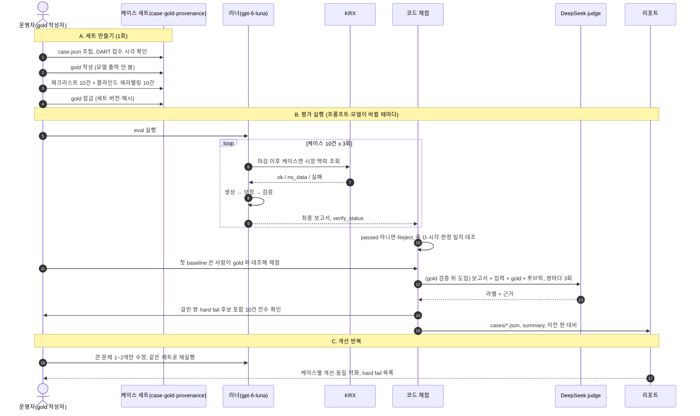

# 종목 변동 보고서 Eval 요약

값 정의는 `ai/evals/rubric.md` 참고. 이 문서는 "무엇을, 무엇과 비교해, 어떤 순서로 평가하는가" 를 한눈에 보는 요약임.

## 1. 목적과 원칙

- 보고서(`gpt-6-luna` 생성)를 **사람이 검증한 정답(gold)** 과 대조해, 고치기 전후를 같은 잣대로 비교함.
- 절대 점수가 아니라 **개선 추적**용. 10건, gold 작성자 1명, 케이스 단위 비교(개선 / 동일 / 악화).
- 순서는 **gold 사람 검증 → 잠금 → 생성 → 채점**. gold 가 틀리면 judge 를 몇 번 돌려도 틀린 기준에 일관되게 맞출 뿐이라, gold 검증 전에는 생성도 judge 도 돌리지 않음.

## 2. 전체 그림

```
case.json ──→ [러너: gpt-6-luna 가 3회 생성] ──→ 보고서
 (모델 입력)                                        │
                                                    │ 대조
gold.json ──────────────────────────────────────────┤
 (정답지, 모델에 안 줌)                              ▼
                              축별 채점 → hard fail 확인 → 케이스 결과 → 수정 전후 비교
```

- 모델은 `case.json` 만 봄. gold 는 채점할 때만 쓰임.
- 코드가 재는 것: 수치·방향어·시각·판정 일치(틀릴 수 없는 규칙). 의미 판단(과장·누락·출처·불확실성)은 사람이 하고, 나중에 judge 가 초안을 냄.

## 3. 평가 기준

### 6개 축

| 축 | 보는 것 | 누가 재나 |
|---|---|---|
| A 출처 정확성 | 주장과 인용 출처가 맞는가 | judge 초안 + 사람 확정 |
| B 인과 과장 | 문장 강도 ≤ gold 허용 최대 강도인가 | 강도는 judge·사람, 시간 선후는 코드 |
| C 원인 누락 | gold 의 핵심 사건(`must`)을 담았나, 없는 원인을 만들진 않았나 | judge 초안 + 사람 확정 |
| D 시장 비교 | "더/덜 움직였다"가 KRX 수치·방향과 맞는가 | 코드 |
| E 불확실성 | 원인 없는 날 지어내지 않았나, 판정·강도·서술이 맞나 | 코드 + judge |
| F 초보자 이해 | 읽고 이해되나 | 자동 지표 + 초보자 패널(3~5건) |

### 치명 실패(hard fail) — 하나라도 있으면 그 보고서는 Reject

`HF_LEAKAGE`(cutoff 이후 정보 사용) · `HF_FABRICATED`(입력에 없는 사실) · `HF_CONTRADICTS`(출처와 반대) · `HF_FALSE_CAUSE`(원인 없는 날 단정) · `HF_MARKET_WRONG`(더↔덜 반대) · `HF_ADVICE`(매매 권유)

### 인과 강도 3단계 (gold 가 사건마다 "말해도 되는 최대" 를 정함)

| 값 | 뜻 | 문장 예 |
|---|---|---|
| `coincident` | 같은 시기에 발생했다 | "같은 날 ~도 있었습니다" |
| `possible_contributor` | 영향을 줬을 가능성이 있다 | "~영향을 줬을 수 있습니다" |
| `likely_cause` | 주요 원인으로 지목된다 | "~가 주된 요인으로 풀이됩니다" |

보고서 문장이 gold 허용 강도보다 세면 **과장**. 인과 없는 사실 서술은 어느 사건에나 허용. 원인 단정("~때문에 ~했습니다")은 gold 에 값이 없어 항상 과장임. 복수 원인인 날은 사건 중요도에 따라 `must` → `likely_cause`, `should` → `possible_contributor`, `optional` → `coincident`.

### 판정과 운영 규칙
- 판정은 층별: `move`(등락) / `relative`(코스피 대비). 값은 `explained` · `partially_explained` · `no_clear_cause`. 층 크기가 ±1 이하면 `no_clear_cause`.
- 누수 판정선은 자료 기준 `cutoff`(화면 기준 `asOf` 아님).

## 4. Eval set

### 케이스 10건 (대상일 2026-10-19~10-30, 위치 `ai/evals/cases/`)

| # | 종목·날짜 | 등락 / 코스피 | 노리는 함정 |
|---|---|---|---|
| 1 | SK하이닉스 10-28 | +10.89 / +6.63 | 복수·상충 원인 |
| 2 | 삼성전자 10-29 | −4.13 / −1.24 | 공시 13건 속 핵심 구분, 더 내린 하락 |
| 3 | SK하이닉스 10-23 | +4.42 / +0.30 | 풍문·미확인 |
| 4 | SK하이닉스 10-26 | −0.16 / −1.46 | 풍문·정정, 덜 내린 하락 |
| 5 | 삼성전기 10-30 | −7.50 / −3.48 | 호재 공시인데 급락 |
| 6 | HD현대 10-28 | +6.53 / +6.63 | 유사 종목 혼동, 시장 몫이 전부 |
| 7 | 삼성전자 10-26 | −1.16 / −1.46 | 원인 없는 날 |
| 8 | LG디스플레이 10-22 | −1.63 / −3.52 | 시장 급락일, 실적 혼재(영업이익 소폭 하회·순이익 상회), 덜 내린 하락 |
| 9 | 삼성전기 10-28 | +8.74 / +6.63 | 사후 누수(cutoff 이후 자료 삽입) |
| 10 | LG이노텍 10-27 | +2.04 / +3.09 | 덜 오른 상승일 |

10건 전부 노리는 함정이 있어서 "잘 쓰는 날의 품질 저하" 는 이 세트로 보지 못함.

### 케이스 폴더 구성

```
ai/evals/cases/c05_009150_2026-10-30/
  case.json         모델 입력 (cutoff 이전 메시지)            조립 완료
  provenance.json   자료별 공개 시각 근거, 공시 접수 시각 대기   조립 완료
  gold.json         사람이 쓰는 정답                          뼈대만 있음
  notes.md          라벨링 중 망설인 점 (선택)
```

## 5. gold.json — 무엇을 쓰고, 어디에 쓰이나

### 5-1. 직접 쓰는 칸 (예시)

가상 종목 "솔마루전자 −4.2%, 코스피 −0.5%" 예시임. 실제 케이스 내용은 앵커링을 피하려고 쓰지 않음. 뼈대에서 `market_expectation`·`time_expectation` 은 이미 채워 두었고 아래가 직접 쓸 칸임.

```json
{
  "expected_verdict": { "move": "explained", "relative": "explained" },
  "confidence_level": "partial",
  "events": [
    {
      "id": "e1",
      "summary": "3분기 영업이익 잠정치 412억원, 예상치 대비 30% 하회 공시",
      "importance": "must",
      "layer": ["move", "relative"],
      "expected_mention": "factors",
      "stance": "bearish",
      "max_causal_strength": "likely_cause",
      "supporting_sources": [{ "url": "https://t.me/sample_channel_a/101", "tier": "primary" }],
      "key_facts": ["412억원", "하회"],
      "rationale": "직접 공시, 장 시작 전 발표, 방향 일치. 낙폭 전부를 설명한다고 볼 근거는 없음"
    },
    {
      "id": "e2",
      "summary": "스마트폰 수요 둔화 우려로 부품 업종 약세",
      "importance": "should",
      "layer": ["move"],
      "expected_mention": "either",
      "stance": "bearish",
      "max_causal_strength": "coincident",
      "supporting_sources": [{ "url": "https://t.me/sample_channel_b/202", "tier": "secondary" }],
      "rationale": "간접 재료(업종). 종목을 직접 언급하지 않음"
    }
  ],
  "forbidden_claims": [
    { "id": "f1", "type": "false_cause", "subject": "영업이익 부진", "relation_min": "likely_cause", "object": "주가", "direction": "down",
      "example": "영업이익 부진이 하락의 유일한 원인이다" },
    { "id": "f2", "type": "fabricated_cause", "subject": "외국인 매도", "relation_min": "none", "object": "주가", "direction": "down",
      "example": "외국인 매도가 하락 원인이다" }
  ],
  "unconfirmed_items": [],
  "unknowns": ["외국인·기관 수급", "하락폭이 시장보다 컸던 이유"],
  "beginner_terms": ["영업이익 잠정치"]
}
```

### 5-2. 쓰는 순서
1. `case.json` 메시지를 읽고 **사건 목록**을 씀(`events`, 케이스당 1~3개 목표).
2. 사건마다 정함: `importance`(빠지면 오답인가), `max_causal_strength`(어디까지 말해도 되나), `stance`(주가에 호재/악재). 공개 시각은 쓰지 않고 근거 메시지·공시 시각에서 계산함.
3. 사건 전체를 보고 층별 `expected_verdict` 와 `confidence_level` 을 씀.
4. 마지막으로 `forbidden_claims`("이렇게 쓰면 실패" 문장)를 씀.
5. 망설인 곳은 `notes.md` 에.

원인이 없는 날(7번)은 `events: []`, 두 층 `no_clear_cause`, `confidence_level: none`, `forbidden_claims` 에 "지어낸 원인". 값 정의는 `ai/evals/rubric.md`.

### 5-3. gold 칸이 평가에서 쓰이는 곳

| gold 칸 | 쓰이는 곳 | 채점 방식 |
|---|---|---|
| `expected_verdict` | 축 E | 보고서의 `verdict`·`relativeVerdict` 와 코드가 비교. 원인 없는 날 `explained` 면 `HF_FALSE_CAUSE` 후보 |
| `max_causal_strength` | 축 B | 보고서 문장 강도를 분류해 gold 허용치와 비교. 더 세면 과장 |
| `importance: must` | 축 C | 보고서가 그 사건을 담았는지. 없으면 누락, 입력에 있었는지로 `upstream`/`generation` 귀속 |
| `expected_mention` | 축 C | 원인 칸과 배경 칸을 바꿔 썼는지(`PLACEMENT`) |
| `supporting_sources`, `key_facts` | 축 A | 인용 source 가 gold 목록에 있거나 본문에 핵심 사실이 있는지(URL 일치가 아니라 증명 여부) |
| (근거 시각, 계산값) | 축 B, 누수 | `supporting_sources` 시각으로 재료가 급등락 이후에 나왔는지, `cutoff` 이후 자료를 썼는지 확인 |
| `stance` | 축 B | 방향이 뒤집혔는지(호재를 하락 원인으로 등) |
| `forbidden_claims` | 축 B, E | 문자열이 아니라 주체·관계·방향 조건으로 의미 대조(보고서 주장을 구조화해 비교) |
| `unknowns` | 축 E, 허위 | 입력으로 알 수 없는 영역을 단정했는지 대조. 모른다고 쓰면 정상 |
| `market_expectation` | 축 D | 보고서의 "더/덜" 문장을 KRX 수치와 코드가 대조. 사람이 쓰는 칸 아님 |
| `beginner_terms` | 축 F | 패널 대상 케이스에서 용어 설명 확인 |

### 5-4. 채점 예시 (가정)

보고서 문장: "영업이익이 예상치를 크게 밑돌아 하락한 것입니다. 외국인 매도도 영향을 줬습니다."

| 문장 | 비교 기준 | 결과 |
|---|---|---|
| "영업이익이 … 하락한 것입니다" | e1 허용 `likely_cause` | 단정이라 `OVERCLAIM`(축 B) |
| "외국인 매도도 영향을 줬습니다" | `forbidden_claims` 2번 | 입력에 없는 원인, `HF_FABRICATED` 후보 |
| 스마트폰 수요 둔화 언급 없음 | e2 는 `should` | 누락 아님(`must` 가 아님) |

`HF_*` 후보는 사람이 직접 확인해 확정함.

## 6. 평가 파이프라인

### 6-1. Sequence diagram



### 6-2. 단계별 설명

1. **gold 검증·잠금(A):** 체크리스트 10건(시각·출처·시장·판정·금지 주장)과 블라인드 재라벨링 10건을 마치고 세트 버전·해시를 기록함. 이 뒤에만 생성을 돌림.
2. **생성(B):** 케이스당 3회, 총 30건. 마감 이후 케이스는 러너가 KRX 로 시장 비교를 계산함(`ai/.env` 의 KRX 키가 동작해야 축 D 가 채점됨).
3. **코드 채점:** `verify_status` 가 `passed` 가 아니면 Reject 로 셈. 판정 일치, 시각, 시장 비교 수치·방향어를 대조함.
4. **사람 baseline 채점:** 첫 baseline 은 사람이 gold 와 대조해 의미 판단(과장·누락·출처·불확실성)을 함.
5. **judge 도입:** 그 뒤 DeepSeek 을 같은 생성 결과에 3회 돌려 초안을 내고, 사람 채점과 비교해 얼마나 믿을지 봄. 갈린 쌍과 hard fail 후보는 사람이 확인함.
6. **개선 반복(C):** 실패 유형을 분류하고 큰 문제 1~2개만 한 번에 하나씩 고쳐 같은 세트로 재실행함. 케이스별 개선·동일·악화로 비교하고 hard fail 은 전부 나열함. 노이즈(같은 프롬프트를 두 번 돌렸을 때의 흔들림)보다 변화가 클 때만 개선으로 인정함.

